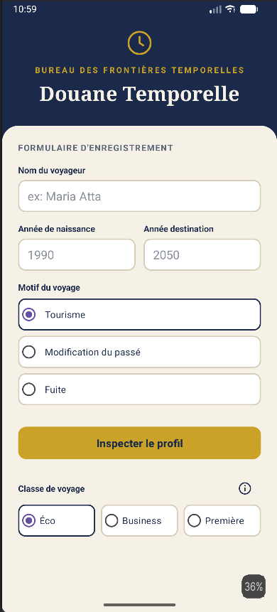
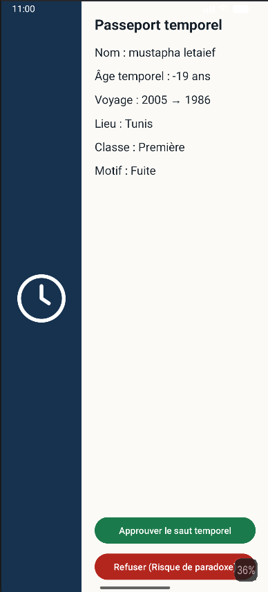
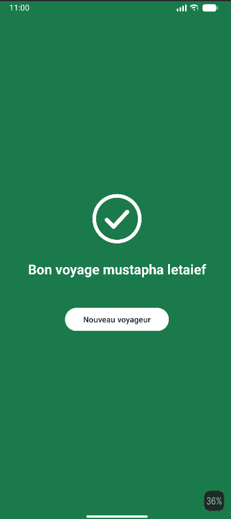
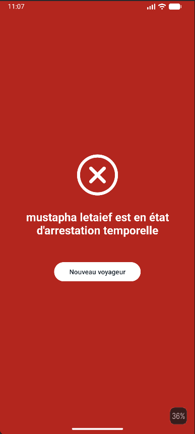

# Douane Temporelle : Time Travel Customs

[](#stack-technique)
[](#stack-technique)
[](#stack-technique)
[](#aperçu)

**Douane Temporelle** est une application Android qui simule un poste de douane pour les voyageurs du temps. Le voyageur remplit un formulaire d'enregistrement, un agent inspecte son "passeport temporel" et rend un verdict : saut temporel **approuvé** ou **refusé** (risque de paradoxe).

Projet réalisé dans le cadre du mini-projet **DS 1** du cours **Programmation Mobile** (3ème année Licence BI, FSEGT), encadré par **M. Nidhal Jelassi**.

---

## Table des matières

1. [Équipe](#équipe)
2. [Aperçu](#aperçu)
3. [Captures d'écran](#captures-décran)
4. [Architecture](#architecture)
5. [Fonctionnalités par activité](#fonctionnalités-par-activité)
6. [Transmission des données (Intents et clés)](#transmission-des-données-intents-et-clés)
7. [Contraintes du sujet](#contraintes-du-sujet)
8. [Stack technique](#stack-technique)
9. [Arborescence des fichiers](#arborescence-des-fichiers)
10. [Branches Git](#branches-git)
11. [Démarrage rapide](#démarrage-rapide)
12. [Workflow Git](#workflow-git)
13. [Conventions de code](#conventions-de-code)

---

## Équipe

| Nom | Rôle | Activité réalisée |
|---|---|---|
| **Mustapha Letaief** | Développeur | **Activité 1** : `MainActivity` (formulaire d'enregistrement) |
| **Melek Gazzeh** | Développeuse | **Activité 2** : `VerificationActivity` (scanner de paradoxe) |
| **Yasmine Yakoudi** | Développeuse | **Activité 3** : `ResultActivity` (verdict) |

---

## Aperçu

Le voyageur du temps arrive au poste de douane :

1. **Enregistrement** : il saisit son nom, son année de naissance, son année de destination et le motif de son voyage (*Tourisme*, *Modification du passé*, *Fuite*).
2. **Inspection** : l'agent voit un billet/passeport avec le nom, l'âge temporel et le motif, puis décide d'approuver ou de refuser.
3. **Verdict** : l'écran devient **vert** (« Bon voyage [Nom] ») ou **rouge** (« [Nom] est en état d'arrestation temporelle »).

### Les motifs de voyage

| Motif | Signification | Risque (fictif) |
|---|---|---|
| **Tourisme** | Visiter une époque, observer sans intervenir | Faible |
| **Modification du passé** | Changer des événements déjà survenus, risque de **paradoxe temporel** | Très élevé |
| **Fuite** | Échapper à sa situation (justice, dette, danger) | Moyen à élevé |

---

## Captures d'écran

<table>
  <tr>
    <td align="center"><b>Activité 1</b><br/>Formulaire d'enregistrement</td>
    <td align="center"><b>Activité 2</b><br/>Passeport / scanner de paradoxe</td>
  </tr>
  <tr>
    <td></td>
    <td></td>
  </tr>
  <tr>
    <td align="center"><b>Activité 3</b><br/>Voyage approuvé</td>
    <td align="center"><b>Activité 3</b><br/>Voyage refusé</td>
  </tr>
  <tr>
    <td></td>
    <td></td>
  </tr>
</table>

---

## Architecture

L'application suit une architecture simple à **3 activités** reliées par des **Intents explicites**. Une classe utilitaire partagée, `Cles`, centralise la construction des clés de transport des données.

---

## Fonctionnalités par activité

### Activité 1 : `MainActivity` (formulaire d'enregistrement)

*Développée par Mustapha Letaief.*

- Champs : **nom**, **année de naissance**, **année de destination** (saisie numérique), **motif** (liste déroulante ou boutons radio).
- Bouton **« Inspecter le profil »**.
- Validation avant envoi : champs non vides, années numériques, destination non inférieure à la naissance.
- Lancement de l'Activité 2 par un **Intent explicite** portant les données saisies.

### Activité 2 : `VerificationActivity` (scanner de paradoxe)

*Développée par Melek Gazzeh.*

- Layout imposé : `LinearLayout` **horizontal** racine, **image à gauche (poids 0.3)** et **`RelativeLayout` à droite (poids 0.7)**.
- Aspect **billet / passeport** : nom, âge temporel calculé, motif.
- Deux boutons : **« Approuver le saut temporel »** et **« Refuser (Risque de paradoxe) »**.
- Règle du nombre premier : bouton **Approuver désactivé** au chargement dans le cas du paradoxe.
- Chaque bouton lance l'Activité 3 avec le **verdict (booléen)** et le **nom du voyageur**.

### Activité 3 : `ResultActivity` (verdict)

*Développée par Yasmine Yakoudi.*

- Écran simple dont le **fond change selon le verdict** : vert (approuvé), rouge (refusé).
- Message personnalisé : **« Bon voyage [Nom] »** ou **« [Nom] est en état d'arrestation temporelle »**.
- Bouton **« Nouveau voyageur »** : retour à `MainActivity` en **vidant la pile des activités** (`FLAG_ACTIVITY_NEW_TASK | FLAG_ACTIVITY_CLEAR_TASK`), pour que le bouton Retour ne ramène pas aux anciens écrans.
- Valeur par défaut du verdict : **refusé**, par sécurité.

---

## Transmission des données (Intents et clés)

Toutes les clés des `putExtra` sont **préfixées par les 4 derniers chiffres de la carte étudiant d'un membre** et sont **construites par des méthodes statiques** de la classe `Cles`. Aucune clé n'est écrite en dur.

| Donnée | Méthode (`Cles`) | Suffixe de la clé | Envoyée de | Vers | Type |
|---|---|---|---|---|---|
| Nom du voyageur | `cleNom(matricule)` | `NOM_VOYAGEUR` | Act. 1 puis 2 | Act. 2 puis 3 | texte |
| Année de naissance | `cleAnneeNaissance(matricule)` | `ANNEE_NAISSANCE` | Act. 1 | Act. 2 | nombre |
| Année de destination | `cleAnneeDestination(matricule)` | `ANNEE_DESTINATION` | Act. 1 | Act. 2 | nombre |
| Motif | `cleMotif(matricule)` | `MOTIF` | Act. 1 | Act. 2 | texte |
| Classe de voyage *(extra)* | `cleClasse(matricule)` | `CLASSE` | Act. 1 | Act. 2 | texte |
| Lieu *(extra)* | `cleLieu(matricule)` | `LIEU` | Act. 1 | Act. 2 | texte |
| Verdict | `cleVerdict(matricule)` | `VERDICT` | Act. 2 | Act. 3 | booléen |

Exemple de clé produite : `1234_NOM_VOYAGEUR` (le matricule est défini par la constante `Cles.MATRICULE`).

> Les champs « classe » et « lieu » sont des **extras facultatifs** de l'Activité 1 ; leur présence dans le formulaire final dépend de l'évolution de la branche `activite1-ameliorations`.

---

## Contraintes du sujet

| Contrainte | Détail |
|---|---|
| Layout de l'Activité 2 | `LinearLayout` horizontal ; image (poids 0.3) + `RelativeLayout` (poids 0.7) |
| Clés des `putExtra` | Préfixe = 4 derniers chiffres d'une carte étudiant ; méthode statique ; jamais en dur |
| Règle du nombre premier | « Modification du passé » + différence première = bouton Approuver désactivé au chargement |
| IDs des éléments | Chaque ID de `TextView`, `EditText`, `Button` contient les **initiales** d'un membre |
| Commentaires | Code commenté en **arabe** (avec chiffres) |
| Intents | **Explicites** |
| Retour au début | « Nouveau voyageur » ferme les activités précédentes |
| GitHub | Nombre de commits >= nombre de jours alloués (6 jours = 6 commits minimum) ; un seul membre dépose le lien sur Classroom |
| Groupe | 3 étudiants maximum ; liberté totale pour ajouter des fonctionnalités |
| Date limite | **Mercredi 11 novembre à 16h** |

---

## Stack technique

| Élément | Technologie |
|---|---|
| Plateforme | Android |
| Langage | Java |
| IDE | Android Studio |
| Build | Gradle (Kotlin DSL : `build.gradle.kts`) |
| Interface | XML (Layouts, Drawables, Resources) |
| Navigation | Intents explicites |
| Gestion de version | Git et GitHub |
| Package | `com.example.douane` |

---

## Arborescence des fichiers

```
Ds1/
├── app/
│   ├── build.gradle.kts
│   └── src/
│       ├── main/
│       │   ├── AndroidManifest.xml
│       │   ├── java/com/example/douane/
│       │   │   ├── Cles.java                    # Clés partagées des putExtra
│       │   │   ├── MainActivity.java            # Activité 1 : formulaire
│       │   │   ├── VerificationActivity.java    # Activité 2 : scanner de paradoxe
│       │   │   └── ResultActivity.java          # Activité 3 : verdict
│       │   └── res/
│       │       ├── drawable/                    # bg_carte, bg_champ, bg_option, ic_horloge, image du passeport...
│       │       ├── layout/
│       │       │   ├── activity_main.xml
│       │       │   ├── activity_verification.xml
│       │       │   └── activity_result.xml
│       │       ├── mipmap-*/                    # Icônes de l'application
│       │       ├── values/
│       │       │   ├── colors.xml               # Palette (dont vert_approuve et rouge_refuse)
│       │       │   ├── strings.xml              # Textes de l'interface
│       │       │   └── themes.xml
│       │       ├── values-night/
│       │       │   └── themes.xml
│       │       └── xml/                         # backup_rules, data_extraction_rules
│       ├── androidTest/java/com/example/douane/
│       │   └── ExampleInstrumentedTest.java
│       └── test/java/com/example/douane/
│           └── ExampleUnitTest.java
├── gradle/
│   ├── libs.versions.toml
│   ├── gradle-daemon-jvm.properties
│   └── wrapper/
├── screenshots/                         # Captures d'écran du README
├── build.gradle.kts
├── settings.gradle.kts
├── gradle.properties
├── gradlew
├── gradlew.bat
├── .gitignore
└── README.md
```

### Répartition des fichiers par membre

| Membre | Fichiers principaux |
|---|---|
| **Mustapha Letaief** (Act. 1) | `MainActivity.java`, `activity_main.xml`, drawables du formulaire (`bg_champ`, `bg_option`...), `Cles.java` |
| **Melek Gazzeh** (Act. 2) | `VerificationActivity.java`, `activity_verification.xml`, image et drawables du passeport |
| **Yasmine Yakoudi** (Act. 3) | `ResultActivity.java`, `activity_result.xml`, couleurs et textes du verdict dans `colors.xml` et `strings.xml`, déclaration dans `AndroidManifest.xml` |

---

## Branches Git

| Branche | Rôle |
|---|---|
| `master` | Branche principale : version intégrée du projet |
| `activite1-ameliorations` | Améliorations de l'Activité 1 (design, retrait de champs) |
| `activite2` | Travail de l'Activité 2 |
| `feature/verification-layout` | Activité 2 : structure du layout et du passeport |
| `feature/verification-logic` | Activité 2 : logique (âge, nombre premier, boutons) |
| `activite3` | Travail de l'Activité 3 |
| `feature/result-layout` | Activité 3 : layout de `ResultActivity` |
| `feature/result-colors-strings` | Activité 3 : couleurs vert/rouge et textes du verdict |
| `feature/result-logique` | Activité 3 : lecture du verdict et affichage du résultat |
| `feature/result-manifest` | Activité 3 : déclaration de `ResultActivity` dans le manifeste |
| `feature/result-ids-initiales` | Activité 3 : IDs avec initiales |
| `feature/result-commentaires-arabizi` | Activité 3 : commentaires de code |

---

## Démarrage rapide

### Prérequis

- **Android Studio** (version récente) avec un SDK Android et un émulateur (ou un téléphone en mode débogage USB).
- **Git** installé.
- Accès au dépôt (le dépôt est **privé** : être ajouté comme collaborateur).

### Installation

```powershell
# Cloner le dépôt
git clone https://github.com/mustaphaletaief-ship-it/Ds1.git

# Entrer dans le projet
cd Ds1

# Vérifier l'état
git status
```

Puis dans Android Studio : **File, Open**, sélectionner le dossier `Ds1`, attendre la fin du **Gradle Sync**, et cliquer sur **Run**.

### Configuration avant le rendu

- **Matricule** : définir dans `Cles.MATRICULE` les 4 derniers chiffres de la carte étudiant d'un membre du groupe.
- **Initiales** : les IDs des éléments d'interface se terminent par les initiales d'un membre.

### Scénarios de test

| Test | Résultat attendu |
|---|---|
| Formulaire valide puis « Inspecter le profil » | L'écran passeport affiche nom, âge temporel et motif |
| **Approuver** | Fond vert et « Bon voyage [Nom] » |
| **Refuser** | Fond rouge et « [Nom] est en état d'arrestation temporelle » |
| **Nouveau voyageur** | Retour au formulaire vide ; le bouton Retour ne ramène pas au verdict |
| 1990 vers 2027 + « Modification du passé » | Bouton Approuver désactivé |
| 1990 vers 2050 + « Modification du passé » | Bouton Approuver actif |

---

## Workflow Git

```powershell
# Vérifier l'état et les nouveautés
git status
git fetch --all --prune

# Mettre master à jour
git checkout master
git pull origin master

# Travailler sur sa branche d'activité
git checkout activite3
git merge master

# Enregistrer et envoyer son travail
git add <fichier ou chemin complet>
git commit -m "Act3: message du commit"
git push

# Fusionner son activité dans master (quand elle est prête et compile)
git checkout master
git merge --no-ff activite3 -m "Fusion de activite3 dans master"
git push origin master
```

### Bonnes pratiques

1. Travailler sur **sa propre branche**, jamais directement sur `master` pour du code en cours.
2. Faire des **commits petits et fréquents** (un commit par étape : layout, logique, manifeste...).
3. Faire un `git pull` avant de recommencer à travailler.
4. Ne fusionner dans `master` que si le projet **compile** et fonctionne.
5. Ne pas fusionner la branche d'un collègue à sa place : le prévenir.
6. Vérifier avant le rendu que tout est poussé :
   ```powershell
   git log --branches --not --remotes --oneline   # vide = tout est poussé
   git branch -r --no-merged origin/master        # vide = rien en attente
   ```

---

## Conventions de code

- **Commentaires** en **arabe** (avec chiffres), conformément au sujet.
- **IDs** au format `type_nom_initiales` (par exemple `btn_nouveau_voyageur_xx`).
- **Textes** de l'interface dans `strings.xml`, **couleurs** dans `colors.xml` (pas de valeurs en dur dans les layouts).
- **Clés `putExtra`** uniquement via la classe `Cles` (méthodes statiques).
- **Intents explicites** uniquement.

---

*Projet réalisé pour le cours de Programmation Mobile, 3ème BI, FSEGT. Date limite de dépôt : mercredi 11 novembre à 16h.*
